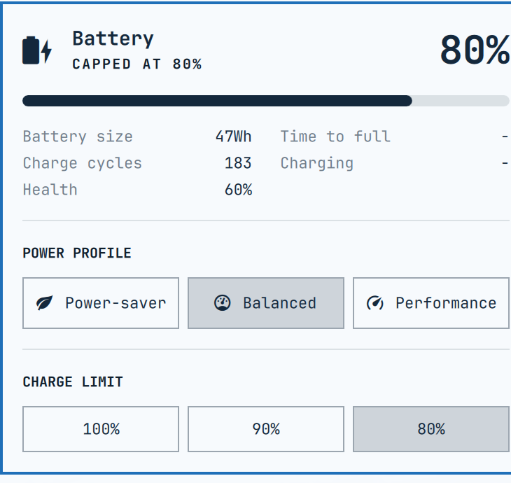

# Battery (io.github.sspaeti.battery)

Omarchy bar battery panel, forked from the stock `omarchy.power` widget, with
three additions:

- **Charge cycles** read from `raw_cycle_count` when `cycle_count` is 0
  (uniwill/TUXEDO ECs never fill `cycle_count`).
- **Health** row: `charge_full / charge_full_design`.
- **CHARGE LIMIT** buttons (100% / 90% / 80%) for TUXEDO laptops, backed by the
  `tuxedo_keyboard` driver's `charging_profile` sysfs attribute. Hidden on
  machines without it. While a cap is active the EC reports a fake 100%, so
  the panel estimates the real level from pack voltage instead and shows
  "Capped at 80%", "Charging to 90%" or "Holding, cap 100%" (EC says Full
  but is below the cap: it only resumes charging after dropping a few
  percent, unplugging briefly usually kicks it).



Everything else (power profile picker, phrases, keyboard navigation) is the
stock Omarchy panel, so this stays drop-in compatible.

## Install

```bash
git clone git@github.com:sspaeti/omarchy-battery-powermanagement.git \
  ~/.config/omarchy/plugins/io.github.sspaeti.battery
```

Then in `~/.config/omarchy/shell.json` replace `"id": "omarchy.power"` with
`"id": "io.github.sspaeti.battery"` (or `omarchy bar move`). Restart the shell:

```bash
omarchy restart shell
```

To go back to stock, swap the id back. `omarchy.power` is never touched.

### TUXEDO charge limit (optional, needs sudo once)

The EC register is root-only and resets to 100% on every boot, so the buttons
need a root helper, a sudoers rule limited to exactly three invocations, and a
boot service that re-applies the cap:

```bash
make install-system          # == sudo ./install-system.sh [user] [profile]
```

Installs:

| File | Purpose |
|---|---|
| `/usr/local/bin/tuxedo-charging-profile` | writes `charging_profile`; waits up to 30 s for the attr at boot |
| `/etc/sudoers.d/tuxedo-charging` | NOPASSWD for the three valid profile args only |
| `/etc/systemd/system/tuxedo-charging-profile.service` | oneshot at boot, default `stationary` |

Profiles: `high_capacity` = 100%, `balanced` ≈ 90%, `stationary` ≈ 80%.
This is independent of the power profile (power-saver / balanced / performance).

### Verifying the cap

The EC reports the capped range as 100%, so `capacity` lies, and it reports
`Full` even while 0.7 A flows in. `charging-status.sh` therefore:

1. at rest (current 0) reads pack voltage: ~16.87 V (4.22 V/cell) is truly
   full, ~16.49 V is the 80% cap, interpolated between measured anchors
   (InfinityBook Pro AMD Gen10, 4 cells; other models may need the table tuned);
2. while current flows integrates `current_now` over time from the last
   resting estimate (coulomb counting, state in `$XDG_RUNTIME_DIR`);
3. on discharge defers to the EC and drops the anchor.

The hero line says "Capped at 80%", "Charging to 100%" or "Holding, cap 90%".
Raising the cap does not start charging by itself: the EC resumes only after
the pack drops a few percent, or after an unplug/replug of the charger.

```bash
cat /sys/class/power_supply/BAT0/voltage_now
./charging-status.sh     # what the panel reads
```

## Development

`make test` runs the Model.js unit tests and the charging-status.sh scenario
test (the latter needs the TUXEDO sysfs attribute present).

This repo is the installed plugin. Edit in place; Omarchy hot-reloads most
files, `Panel.qml` needs `make reload`. `make test` runs the Model.js tests.

## License

MIT
